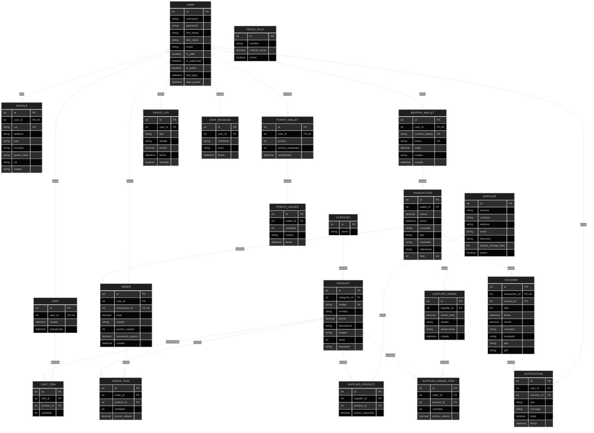

# Modelo de datos

Este diagrama refleja los modelos propios de las aplicaciones. `USER` es el modelo de usuarios que aporta Django; las tablas de permisos, sesiones y administración se generan automáticamente y no son modelos de negocio de MusicPro.

`FK` indica clave foránea, `UK` una columna única y `PK` la clave primaria. Los productos pueden quedar sin categoría; una transacción puede existir sin billetera y una orden sin transacción. `SUPPLIER_PRODUCT` relaciona proveedores y productos, y su par proveedor/producto es único.

Para explicar el modelo en la evaluación, puedes partir por `CATEGORY` y `PRODUCT`: una categoría clasifica varios productos y el producto guarda código único, precio y stock. Luego muestra `ORDER` y `ORDER_ITEM`: esta tabla intermedia permite que una orden incluya varios productos y almacena la cantidad y el precio al momento de la compra.
